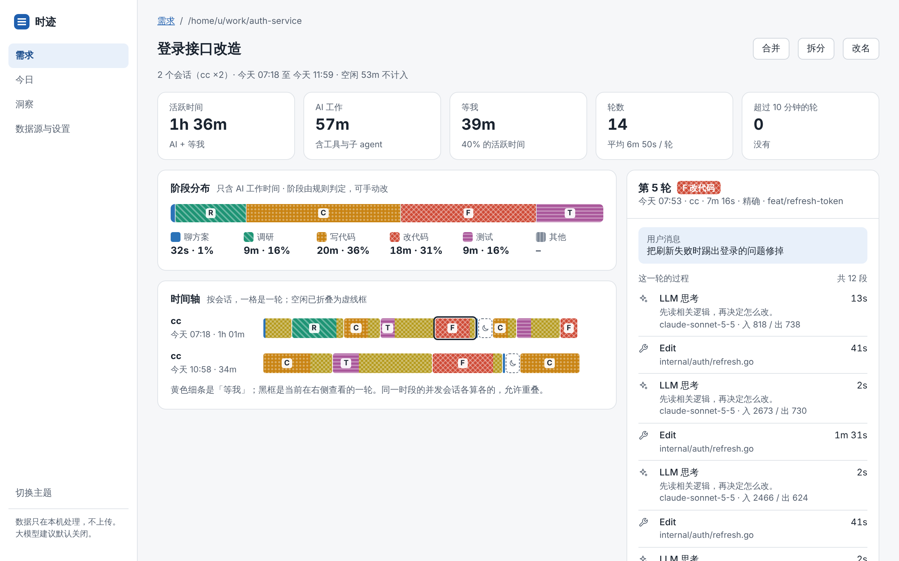
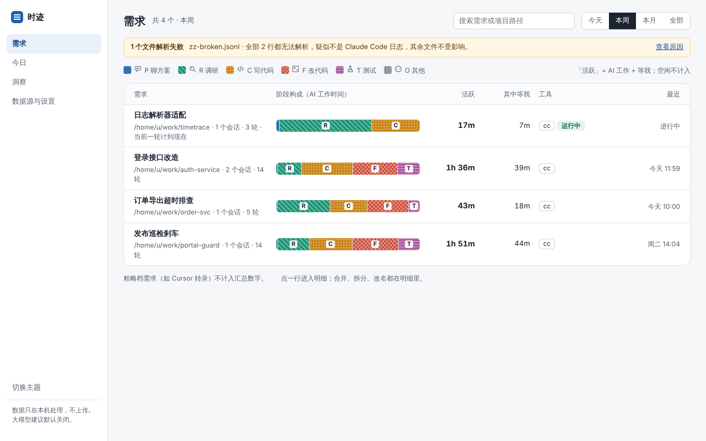
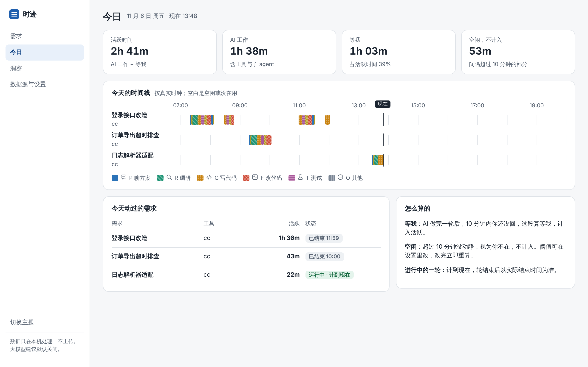
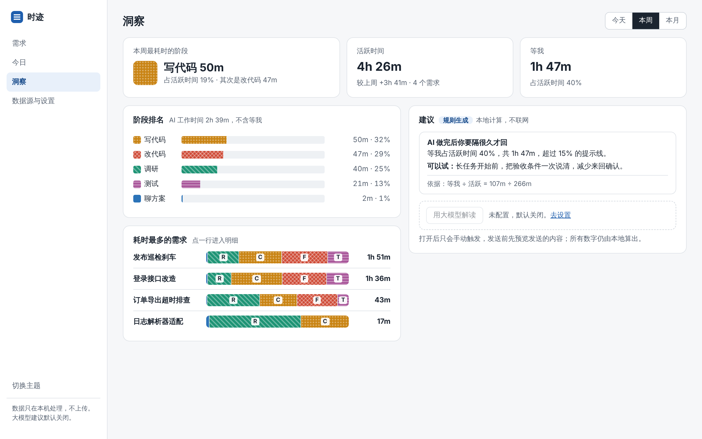
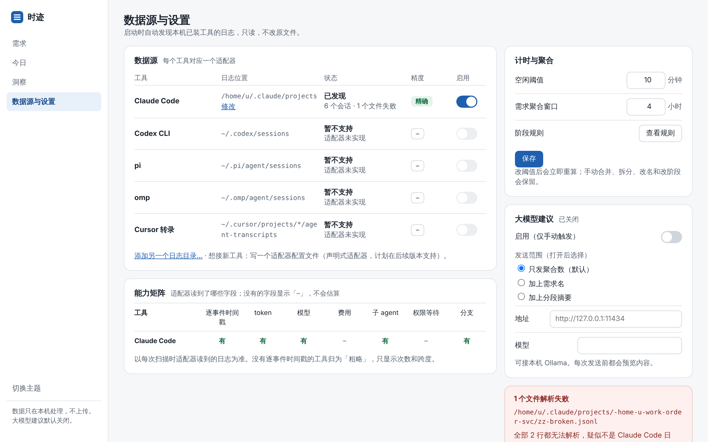
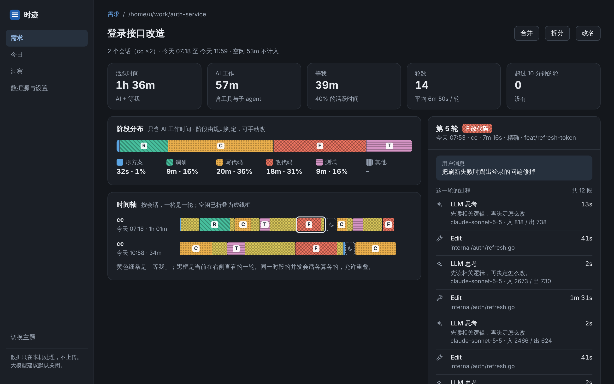
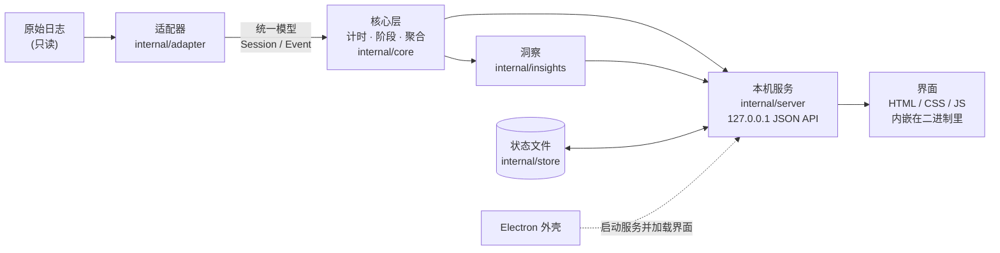

<h1 align="center">时迹 Timetrace</h1>

<p align="center">
  纯本地的桌面客户端:读取 LLM 编码工具的会话日志,告诉你一个需求的时间花在了哪。
</p>

<p align="center">
  <a href="https://github.com/crazyjums/timetrace/actions/workflows/ci-release.yml"></a>
  <a href="https://github.com/crazyjums/timetrace/releases/latest"></a>
  
  
  
</p>

<p align="center">
  
</p>

> **项目状态:早期,自用阶段。** 目前只支持 Claude Code 的日志;其他工具的适配器还在等真实日志样例。计时与阶段规则是按产品简报推断的,尚未对照完整 PRD 校验,见[已知限制](#已知限制)。

## 目录

- [特性](#特性)
- [截图](#截图)
- [下载与安装](#下载与安装)
- [快速开始](#快速开始)
- [计时与阶段规则](#计时与阶段规则)
- [支持的工具](#支持的工具)
- [隐私与安全](#隐私与安全)
- [命令行](#命令行)
- [架构](#架构)
- [开发](#开发)
- [新增一个适配器](#新增一个适配器)
- [已知限制](#已知限制)
- [贡献](#贡献)
- [许可证](#许可证)

## 特性

- **按需求聚合**:同一目录下相邻会话(默认间隔 ≤ 4 小时)自动归为一个需求,可手动合并、拆分、改名,人工修正会保留。
- **阶段拆分**:每一轮自动判定为聊方案 P、调研 R、写代码 C、改代码 F、测试 T、其他 O,另有「等我」W;空闲不计入。阶段由规则判定,可在界面里改单轮。
- **四重编码**:阶段用颜色 + 纹理 + 字母 + 图标同时表达,不依赖颜色单独传达;亮 / 暗两套主题。
- **时间轴与过程**:按会话展示每一轮,点开看这一轮的消息,以及每段 LLM、工具、子 agent 的耗时。
- **今日面板**:按真实时钟看今天各需求用了多久,进行中的轮算到「现在」,并区分运行中 / 等我中 / 已结束。
- **本地洞察**:最耗时的阶段、较上期变化(上期有数据才显示)、Top 需求,以及最多 4 条带「依据」的建议。
- **诚实的数据**:日志里没有的字段显示「–」,不估算;没有逐事件时间戳的工具归为「粗略档」,不显示耗时、不计入汇总。
- **可选的大模型解读**:默认关闭,只能手动触发,发送前先预览内容,支持本机 Ollama。所有数字都由本地算出。
- **纯本地**:没有账号、云同步和遥测;只读打开原始日志,不修改、不删除;解析失败的文件会说明原因,且不影响其他文件。

## 截图

<table>
  <tr>
    <td width="50%"><br><sub><b>需求列表</b> · 时间范围切换、阶段构成条、运行中与解析失败提示</sub></td>
    <td width="50%"><br><sub><b>今日</b> · 真实时钟时间线,运行中 / 等我中 / 已结束</sub></td>
  </tr>
  <tr>
    <td width="50%"><br><sub><b>洞察</b> · 阶段排名、Top 需求、带依据的建议</sub></td>
    <td width="50%"><br><sub><b>数据源与设置</b> · 数据源、能力矩阵、计时、大模型开关</sub></td>
  </tr>
  <tr>
    <td colspan="2"><br><sub><b>暗色主题</b> · 跟随系统,也可在侧栏手动切换</sub></td>
  </tr>
</table>

> 截图使用的是演示数据,不是真实的工作记录。

## 下载与安装

到 [Releases](https://github.com/crazyjums/timetrace/releases) 下载对应平台的桌面客户端(每次合并到 `master` 会自动发布一个版本):

| 平台 | 文件(以 Release 页面为准) | 说明 |
| --- | --- | --- |
| Windows x64 | `Timetrace-Portable-*.exe` | 单文件便携版,双击运行,无需安装 |
| Windows x64 | `Timetrace-Setup-*.exe` | 安装版,可选择安装目录 |
| macOS Apple 芯片 | `Timetrace-*-mac-arm64.dmg` | 拖进「应用程序」 |
| macOS Intel | `Timetrace-*-mac-x64.dmg` | 同上 |
| Linux x64 | `Timetrace-*-linux-x64.AppImage` | `chmod +x` 后运行 |

**注意:**

- 目前没有代码签名。Windows 首次运行会出现 SmartScreen 提示(「更多信息 → 仍要运行」);macOS 首次打开需要到「系统设置 → 隐私与安全性」里放行。
- 没有自动更新,需要手动下载新版本。
- 我只在 Linux 上实际启动过打包后的应用;Windows 和 macOS 的安装包由 GitHub Actions 构建成功,但还没有经过实机验证。遇到问题请[提 issue](https://github.com/crazyjums/timetrace/issues)。

## 快速开始

1. 打开应用。它会自动读取 Claude Code 的默认日志目录:
   - macOS / Linux:`~/.claude/projects`
   - Windows:`%USERPROFILE%\.claude\projects`(路径格式未在 Windows 上核对,不对的话到设置页修改)
2. 「需求」页列出聚合后的需求,点一行进入明细,点时间轴上的一格查看这一轮的过程。
3. 日志不在默认位置?到「数据源与设置」页点「修改」,或「添加另一个日志目录…」,先点「测试扫描」确认能识别再添加。

你的人工修正(改名、合并、拆分、改阶段)和设置保存在本机一个 JSON 文件里,位置由系统的用户配置目录决定:

| 系统 | 路径 |
| --- | --- |
| Linux | `~/.config/timetrace/state.json` |
| macOS | `~/Library/Application Support/timetrace/state.json` |
| Windows | `%AppData%\timetrace\state.json` |

## 计时与阶段规则

> 下列规则来自产品简报的推断,PRD 尚未纳入仓库,存在与最终规则不一致的可能。

**概念**

| 概念 | 含义 |
| --- | --- |
| 会话 | 某个工具的一份日志文件 |
| 轮 | 从用户一条消息,到下一条用户消息之前的最后一个事件;子 agent 和工具回传不会另开一轮 |
| AI 时间 | 一轮内第一个到最后一个事件的间隔 |
| 等我 | 一轮结束后、到下一条用户消息之前,间隔小于空闲阈值的部分(默认阈值 10 分钟) |
| 空闲 | 间隔不小于阈值的部分,视为你不在,**不计入** |
| 活跃时间 | AI 时间 + 等我 |
| 需求 | 同一目录下相邻会话间隔 ≤ 聚合窗口(默认 4 小时)自动聚合;人工合并(可跨目录)与拆分优先于窗口规则 |
| 并发 | 同一需求下的多个会话允许时间重叠,各算各的 |

**进行中的一轮**:最后事件距现在小于空闲阈值时,若 AI 还在干活(最后是工具调用或工具回传),算「运行中」,AI 时间计到现在;若最后是 AI 的最终回复,算「等我中」,等我时间计到现在;否则算「已结束」。

**阶段判定**(纯规则,按优先级,可手动覆盖单轮):

| 优先级 | 阶段 | 条件 |
| --- | --- | --- |
| 1 | T 测试 | Bash 命令匹配 `go test`、`pytest`、`npm test`、`jest`、`cargo test` 等 |
| 2 | F 改代码 | 有 Edit 类工具;或有 Write 且 prompt 含「修复 / 重构」等词 |
| 3 | C 写代码 | 仅有 Write |
| 4 | P 聊方案 | 没有任何工具调用 |
| 5 | R 调研 | 只用 Read / Grep / Glob / WebFetch / WebSearch |
| 6 | O 其他 | 其余 |

**精度分档**:每个事件都有时间戳的是「精确档」,显示轮级和阶段级耗时;只有会话起止时间的是「粗略档」,耗时显示「–」,只显示次数和跨度,不计入任何汇总数字。

## 支持的工具

| 工具 | 状态 | 精度 |
| --- | --- | --- |
| Claude Code | ✅ 已支持 | 精确 |
| Codex CLI | ⏳ 计划中(缺真实日志样例) | 精确 |
| pi / omp | ⏳ 计划中(缺真实日志样例) | 精确 |
| Cursor 转录 | ⏳ 计划中(缺真实日志样例) | 粗略 |

Claude Code 适配器的字段能力:逐事件时间戳、token、模型、子 agent、分支为「有」;费用、权限等待日志里分不出来,显示「–」,权限等待的时间计入 AI 时间。

想让某个工具尽快支持?把一份**脱敏后的真实日志样例**发到 issue 里,比任何描述都有用。

## 隐私与安全

- **数据不出本机**:没有账号、云同步、遥测。界面只访问 `127.0.0.1` 上的本机服务,外链交给系统浏览器打开。
- **只读日志**:不修改、不删除原始日志文件。
- **大模型默认关闭**:打开后也只能手动触发;发送范围分三档(仅聚合数 [默认] / 加需求名 / 加分段摘要),发送前先预览将要发送的 JSON,并且发送内容必须与预览一致;支持本机 Ollama。
- **本机服务加固**:只监听 `127.0.0.1`;修改类请求必须带自定义请求头(防 CSRF)并校验 Host(防 DNS rebinding);来自日志的文本一律转义后再渲染;Electron 关闭 `nodeIntegration`,开启 `contextIsolation` 与沙箱。
- 不会写「高于正常水平」这类断言(没有可信基线);相关性建议会标明「相关,不等于因果」。

## 命令行

核心层可以脱离界面使用:

```bash
go run ./cmd/timetrace list                      # 需求列表与阶段分布(默认命令)
go run ./cmd/timetrace today                     # 今日各需求用时
go run ./cmd/timetrace insights --days 7         # 洞察;7 为自然周,其他值为最近 N 天
go run ./cmd/timetrace llm-preview               # 仅预览将发送给大模型的 JSON
go run ./cmd/timetrace llm-send                  # 预览后发送,需先在设置里启用

# 人工修正(需求键见 list 输出的「键=」)
go run ./cmd/timetrace rename <需求键> <名称>
go run ./cmd/timetrace phase <会话ID> <轮序号> <P|R|C|F|T|O>
go run ./cmd/timetrace merge <会话ID> <会话ID>...   # 强制归为同一需求(可跨目录)
go run ./cmd/timetrace split <会话ID>               # 从该会话起另起需求
```

通用参数:`--claude-dir`(默认 `~/.claude/projects`)、`--state`(状态文件路径)。

## 架构



两条原则:**计时规则只在核心层实现一次**,适配器只提供原始事件和字段;**新增工具只加适配器,不改核心和界面**。

| 路径 | 内容 |
| --- | --- |
| `cmd/timetrace` | 命令行入口 |
| `cmd/timetrace-server` | 本机服务入口(监听 `127.0.0.1`,启动后输出 `LISTENING <地址>`) |
| `internal/model` | 适配器输出的统一模型 |
| `internal/adapter` | 适配器接口与 `claudecode` 实现 |
| `internal/core` | 计时、阶段、需求聚合、区间统计、今日 |
| `internal/insights` | 本地规则洞察 |
| `internal/llm` | 可选的大模型解读(默认关闭) |
| `internal/store` | 人工修正与设置的本机存储 |
| `internal/server` | JSON API 与内嵌界面(`web/`,无构建步骤) |
| `electron/` | Electron 外壳:只启动本机服务并加载界面,不含业务逻辑 |
| `docs/` | 产品简报与界面原型 |

## 开发

需要 Go 1.24+;跑桌面窗口或打安装包还需要 Node.js 20+。

```bash
# 仅浏览器:启动本机服务,按输出的地址访问
go run ./cmd/timetrace-server --port 8765

# Electron 桌面窗口
cd electron && npm install && npm start

# 为当前系统打安装包(产物在 electron/dist/)
cd electron && npm run dist

# 测试与检查(CI 同款)
gofmt -l .
go vet ./...
go test -race ./...
```

**CI 与发布**:`.github/workflows/ci-release.yml`。提交 PR 时跑 `gofmt`、`go vet`、`go test -race` 与前端脚本语法检查;合并到 `master` 后,检查通过则在 Windows / macOS / Linux 的原生 runner 上打包,并自动发布 Release(版本号 `v0.1.<运行序号>`)。

## 新增一个适配器

适配器只做一件事:把某个工具的原始日志翻译成统一模型。

1. 在 `internal/adapter/<tool>/` 实现 `adapter.Adapter` 接口(`ID` / `Discover` / `Parse`):
   - `Discover` 只读扫描目录,返回候选日志文件;
   - `Parse` 只读解析单个文件,输出 `model.Session`(含逐事件的 `model.Event`);解析失败要返回带原因的 error,**不要影响其他文件**;
   - 日志里没有的字段保持零值,界面会显示「–」,**不要估算**。
2. 没有逐事件时间戳的工具,把 `Session.Precision` 设为 `model.Coarse`。
3. 在 `internal/server/server.go` 的 `adapterFor`、`toolCatalog`、`capHas` 里各注册一行。
4. 补测试:输入一份**脱敏的真实日志样例**,断言输出的统一模型(解析层必须能脱离界面单独测试)。

> 不确定的日志格式、API、版本,请先去核对真实样例,不要凭记忆写。

## 已知限制

- 只支持 Claude Code;Codex CLI、pi、omp、Cursor 的适配器缺真实日志样例。
- 计时与阶段规则按产品简报推断,`docs/PRD.md` 不在仓库中,待导出后对照校验。
- 「等我」超过 15% 才给建议、「长轮」按 10 分钟算,是固定的提示线,不是「正常水平」。
- 阶段规则文件暂不支持自定义(界面里是只读的「查看规则」)。
- 大模型解读的 Ollama 调用格式(`/api/chat`)凭记忆编写,**不确定**,首次使用请对照官方文档核对。
- 没有代码签名、没有自动更新、没有自定义应用图标(目前是 Electron 默认图标)。
- 声明式(YAML)适配器、单会话过程视图(span 树)尚未实现。

## 贡献

欢迎 issue 和 PR,尤其是**脱敏的真实日志样例**(Codex CLI、pi、omp、Cursor)。

- 提 PR 前先跑一遍 `gofmt -l .`、`go vet ./...`、`go test -race ./...`。
- 改动请遵守[不能破的规则](CLAUDE.md#不能破的规则):数据全程本机、计时只在核心层实现、缺失字段显示「–」、阶段四重编码、只读日志。
- 产品背景与页面清单见 [`docs/BRIEF.md`](docs/BRIEF.md),界面原型见 [`docs/prototype-canvas/`](docs/prototype-canvas/) 与 [`docs/prototype-v0/`](docs/prototype-v0/)(阶段色板与图标以 `prototype-v0` 为准)。

## 许可证

尚未选择开源许可证(仓库中还没有 `LICENSE` 文件)。在确定之前,默认保留所有权利。
